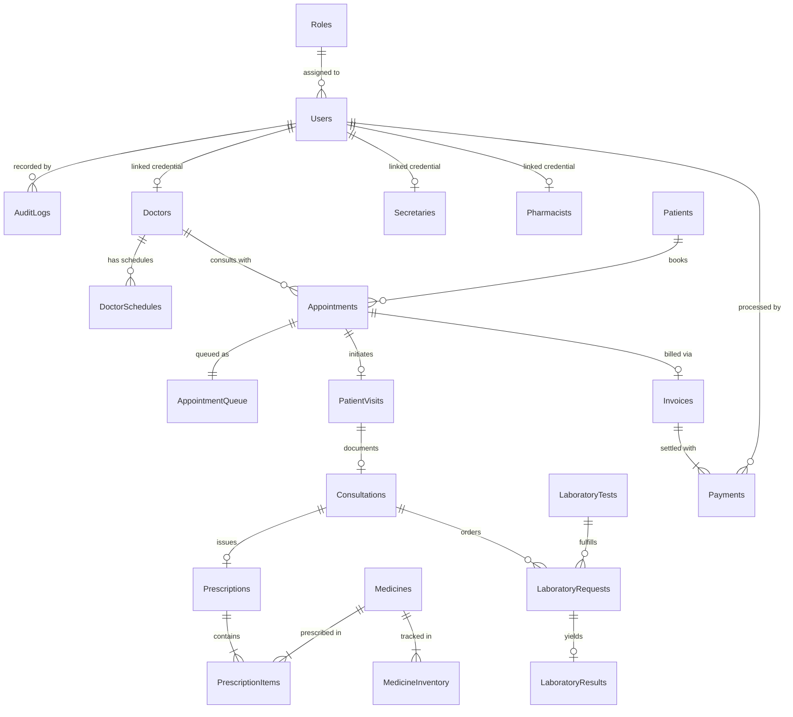

# ClinicFlow — System Architecture & Component Map

> **File:** `Documentation/AI_WORKFLOW/ARCHITECTURE_MAP.md`  
> **Status:** Authoritative Architectural Record  
> **Target Framework:** .NET 10.0 Windows Forms (`net10.0-windows`)  
> **Database:** Microsoft SQL Server 2025 (`ClinicFlowUnifiedDb`)  
> **Architecture Pattern:** Strict 4-Tier Layered Architecture (UI Form → Service/Logic → Repository/Data Access → Relational Database)

---

## 1. Architectural Principles & Invariants

```text
┌────────────────────────────────────────────────────────┐
│                   PRESENTATION TIER                    │
│             Windows Forms (UI Controls & Events)        │
└───────────────────────────┬────────────────────────────┘
                            │ Method Calls (DTOs/Requests)
                            ▼
┌────────────────────────────────────────────────────────┐
│                   BUSINESS LOGIC TIER                  │
│       Services (Validation, RBAC, Business Rules)       │
└───────────────────────────┬────────────────────────────┘
                            │ Method Calls (Models/Parameters)
                            ▼
┌────────────────────────────────────────────────────────┐
│                  DATA ACCESS TIER (DAL)                │
│    Repositories (Parameterized SQL, SqlTransactions)   │
└───────────────────────────┬────────────────────────────┘
                            │ ADO.NET (T-SQL Commands)
                            ▼
┌────────────────────────────────────────────────────────┐
│                  DATABASE STORAGE TIER                 │
│        Microsoft SQL Server (ClinicFlowUnifiedDb)      │
└────────────────────────────────────────────────────────┘
```

### Core Architecture Rules:
1. **No SQL in UI Forms:** Forms must never instantiate `SqlCommand`, format SQL strings, or access connections directly.
2. **No Business Rules in Repositories:** Repositories only execute parameterized queries, manage transactions, and map result sets to models.
3. **No Direct Form-to-Repository Shortcuts:** Workflow decisions (authorization, validation, cross-entity rules) belong in Services.
4. **Parameterized ADO.NET Exclusively:** All commands use `SqlParameter` with explicit `SqlDbType` and length; no string concatenation is permitted.
5. **Atomic Multi-Table State Mutations:** Any operation updating more than one table must be enclosed in `conn.BeginTransaction()`, `tran.Commit()`, and rolled back on exception.

---

## 2. Verified Module & Component Inventory

### 2.1 Entry Point & Configuration
| Component | Source File | Responsibilities | Current Verification Status |
|---|---|---|---|
| **Program Entry** | `ClinicFlow-Unified/Program.cs` | Initializes WinForms, verifies DB connection, checks `AnyUsersExistAsync()`, directs to `InitialSetupForm` or `LoginForm`. | Verified working; cleanly boots into login flow. |
| **Config Loader 1** | `ClinicFlow-Unified/Data/AppConfiguration.cs` | Reads `appsettings.json` via `Microsoft.Extensions.Configuration`. | Verified working for foundation services. |
| **Config Loader 2** | `ClinicFlow-Unified/Data/DatabaseConnection.cs` | Direct JSON parsing with fallback to flat or nested connection string keys. | Verified working for primary repositories. |
| **Connection Factory** | `ClinicFlow-Unified/Data/SqlConnectionFactory.cs` | Produces closed `SqlConnection` instances on demand. | Verified working. |

### 2.2 Presentation Tier (Forms)
| Form Name | Files | Primary Role & Features | Notes & Deficiencies |
|---|---|---|---|
| `LoginForm` | `Forms/LoginForm.cs`, `.Designer.cs` | Collects credentials, calls `AuthenticationService`, sets `UserSession`, routes user by role. | Missing failed attempt counter & lockout feedback. |
| `InitialSetupForm` | `Forms/InitialSetupForm.cs`, `.Designer.cs` | Seeds first Admin account when `dbo.Users` is empty. | Verified working. |
| `MainDashboardForm` | `Forms/MainDashboardForm.cs`, `.Designer.cs` | Main administrative shell hosting nested child modules; sidebar navigation. | Missing logged-in user name/role badge. Role control currently relies on button visibility. |
| `AdminOverviewForm` | `Forms/AdminOverviewForm.cs`, `.Designer.cs` | Embedded overview dashboard; shows 4 KPI cards, live queue grid, recent audit stream. | Verified working with live summary indicators. |
| `PatientForm` | `Forms/PatientForm.cs`, `.Designer.cs` | Patient demographic entry, validation, update, and search list. | Soft-deleted patients cannot be viewed or restored. |
| `PatientRecordsForm` | `Forms/PatientRecordsForm.cs`, `.Designer.cs` | Patient medical chart, timeline, and history view. | Verified working. |
| `AppointmentForm` | `Forms/AppointmentForm.cs`, `.Designer.cs` | Appointment booking, triage, daily queue scheduling, emergency blockout alerts. | Full slot reservation & cancellation working. |
| `DoctorManagementForm` | `Forms/DoctorManagementForm.cs`, `.Designer.cs` | Doctor profile CRUD, credential assignment, schedule links, archive/restore. | Validates existing patient links before delete. |
| `DoctorScheduleForm` | `Forms/DoctorScheduleForm.cs`, `.Designer.cs` | Doctor weekly practice schedule, slot durations, manual slot blockouts, day-off declaration. | Verified atomic schedule update. |
| `DoctorDashboardForm` | `Forms/DoctorDashboardForm.cs`, `.Designer.cs` | Specialized doctor workstation view; shows patient queue, vitals, consultation trigger. | Role-specific workstation form. |
| `DoctorConsultationForm` | `Forms/DoctorConsultationForm.cs`, `.Designer.cs` | Clinical exam, SOAP notes, diagnosis, prescription prescribing, lab orders. | Full transaction workflow with atomic commit. |
| `SecretaryManagementForm`| `Forms/SecretaryManagementForm.cs`, `.Designer.cs`| Secretary staff CRUD, desk assignment, user credential creation, archive/restore. | Deletion physically removes user record (risk). |
| `SecretaryDashboardForm` | `Forms/SecretaryDashboardForm.cs`, `.Designer.cs` | Front-desk triage portal, walk-in check-in, queue status management. | Role-specific workstation form. |
| `PharmacistManagementForm`| `Forms/PharmacistManagementForm.cs`, `.Designer.cs`| Pharmacist account CRUD, license verification, archive/restore. | Verified working. |
| `PharmacistDashboardForm`| `Forms/PharmacistDashboardForm.cs`, `.Designer.cs`| Central pharmacy dispensing queue, batch stock level inspection, stockout tagging. | Handles inventory deduction atomically. |
| `BillingForm` | `Forms/BillingForm.cs`, `.Designer.cs` | Invoicing, payment tender, discount application (Senior/PWD), receipt issuance. | Verified working. |
| `ReceiptPreviewDialog` | `Forms/ReceiptPreviewDialog.cs` | Graphical official receipt rendering with GDI+ and `PrintDocument` preview/print. | Verified working printable document. |
| `PrescriptionSlipDialog`| `Forms/PrescriptionSlipDialog.cs` | Prescription printing with doctor signature line and clinic letterhead. | Verified working printable document. |
| `RestockMedicineDialog` | `Forms/RestockMedicineDialog.cs` | Inventory batch restocking with batch #, expiry, cost price, and preset chips. | Enforces minimum quantity = 1. |
| `BatchDisposalDialog` | `Forms/BatchDisposalDialog.cs` | Expired/damaged medicine stock quarantine and disposal audit trail. | Atomic disposal and audit write. |
| `EmergencyBlockoutDialog`| `Forms/EmergencyBlockoutDialog.cs` | Displaces booked appointments when doctor takes unexpected leave. | Dispatches patients to triage. |
| `EmergencyTriageDialog` | `Forms/EmergencyTriageDialog.cs` | Reschedules or reassigns displaced patients to available peer physicians. | Verified working. |

### 2.3 Business Logic Tier (Services)
| Service | File | Responsibilities | Current Status |
|---|---|---|---|
| `AuthenticationService` | `Services/AuthenticationService.cs` | Authenticates username/password; logs `LOGIN_SUCCESS` / `LOGIN_FAILED`. | Needs account lockout logic and logout auditing. |
| `UserManagementService` | `Services/UserManagementService.cs` | Handles initial Admin creation with 12+ character rule. | Needs extension for general user CRUD. |
| `AuditService` | `Services/AuditService.cs` | Enriches audit records with MachineName and UTC timestamps. | Verified working. |
| `PatientService` | `Services/PatientService.cs` | Validates patient demographics, contact formats, and coordinates repository calls. | Verified working. |
| `PatientHistoryService` | `Services/PatientHistoryService.cs` | Aggregates consultation notes, lab results, prescriptions into patient history DTOs. | Verified working. |
| `AppointmentService` | `Services/AppointmentService.cs` | Checks doctor practice hours, prevents slot double-booking, manages queue transitions. | Verified working. |
| `DoctorConsultationService`| `Services/DoctorConsultationService.cs` | Orchestrates consultation flow: starts visit, generates Rx, updates queue status. | Verified working. |

### 2.4 Data Access Tier (Repositories)
| Repository | File | Primary Database Interactions | Transaction Boundaries |
|---|---|---|---|
| `UserRepository` | `Repositories/UserRepository.cs` | `dbo.Users`, `dbo.Roles` | Single queries. |
| `RoleRepository` | `Repositories/RoleRepository.cs` | `dbo.Roles` | Single queries. |
| `AuditLogRepository` | `Repositories/AuditLogRepository.cs`| `dbo.AuditLogs` (Insert only) | Single queries. Missing query/filtering API. |
| `PatientRepository` | `Repositories/PatientRepository.cs` | `dbo.Patients` | Soft-deletes without checking dependencies. |
| `DoctorRepository` | `Repositories/DoctorRepository.cs` | `dbo.Doctors`, `dbo.Users` | Multi-table atomic transactions on archive/delete. |
| `DoctorScheduleRepository`| `Repositories/DoctorScheduleRepository.cs`| `dbo.DoctorSchedules`, `dbo.DoctorWeeklySchedules`, `dbo.DoctorScheduleExceptions` | Atomic `SqlTransaction` with commit/rollback. |
| `AppointmentRepository` | `Repositories/AppointmentRepository.cs`| `dbo.Appointments`, `dbo.AppointmentQueue`, `dbo.PatientVisits` | Multi-table atomic check-in and queueing. |
| `DoctorConsultationRepository`| `Repositories/DoctorConsultationRepository.cs`| `dbo.Consultations`, `dbo.Prescriptions`, `dbo.PrescriptionItems`, `dbo.LaboratoryRequests` | Multi-table atomic `SqlTransaction`. |
| `BillingRepository` | `Repositories/BillingRepository.cs` | `dbo.Invoices`, `dbo.Payments`, `dbo.Prescriptions` | Multi-table atomic `SqlTransaction`. |
| `PharmacyRepository` | `Repositories/PharmacyRepository.cs` | `dbo.Medicines`, `dbo.MedicineInventory`, `dbo.PrescriptionItems`, `dbo.MedicineDisposalLogs` | Multi-table atomic dispensing & restock. |
| `AdminDashboardRepository`| `Repositories/AdminDashboardRepository.cs`| Aggregated metrics across `Appointments`, `Patients`, `Doctors`, `AuditLogs` | Read-only analytics queries. |
| `SecretaryRepository` | `Repositories/SecretaryRepository.cs`| `dbo.Secretaries`, `dbo.Users` | Multi-table atomic transactions. |

---

## 3. Verified Database Schema & Entity Relationships

The live database `ClinicFlowUnifiedDb` contains 24 tables organized in 3NF:



---

## 4. Security & Authorization Architecture

### 4.1 Authentication Scheme
- **Algorithm:** PBKDF2 with HMAC-SHA256.
- **Salt:** 16 bytes generated cryptographically via `RandomNumberGenerator.GetBytes(16)`.
- **Iterations:** 100,000 iterations.
- **Output:** 48-byte Base64-encoded string combining 16-byte salt and 32-byte subkey.
- **Vulnerability Identified:** Line 45 of `PasswordHasher.cs` contains `if (string.Equals(password, storedHash)) return true;`. This must be removed to enforce "no plain-text passwords anywhere".

### 4.2 Role-Based Access Control Boundaries
Currently defined roles in `dbo.Roles`:
1. `Admin`: Full system access, configuration, user management, audit logs, backup/restore.
2. `Doctor`: Clinical access, patient history, consultation notes, prescriptions, laboratory ordering.
3. `Secretary` / `Receptionist`: Patient registration, appointment booking, queue management, billing/cashier.
4. `Pharmacist`: Central pharmacy inventory, batch restocking, prescription dispensing.
5. `Laboratory Staff`: Diagnostic test execution and result entry.

### 4.3 Missing Security Boundaries:
- `MainDashboardForm` relies on control hiding (`Visible = false`) instead of role assertion guards.
- Service methods do not verify `UserSession.RoleName` before executing privileged domain operations.
- No consecutive failed login tracker; accounts are never locked regardless of brute-force attempts.
- No `LOGOUT` audit log is triggered on sign-out.

---

## 5. Architectural Gap Analysis & Technical Debt

1. **Dual Configuration Strategy:** Modern .NET configuration uses `appsettings.json`, but academic criteria specify `App.config`. Both must be harmonized.
2. **Missing Central Error Logging:** Technical exceptions are either surfaced directly to users or caught without logging. A dedicated `ErrorLogger` writing to `app_error.log` and `dbo.ErrorLogs` is required.
3. **Optimistic Concurrency Missing:** No table currently possesses a `RowVersion` column. Updates to patients, appointments, and inventory risk lost updates if two workstations submit concurrent edits.
4. **Unimplemented Reports Subsystem:** `Reports/` directory is completely empty. Needs three parameter-filtered, grouped reports with CSV and Print capabilities.
5. **No Audit Log Viewer:** Audit records are written to `dbo.AuditLogs`, but there is no Admin UI to query or filter them.
6. **No Database Backup / Restore:** Lacks an in-app administrative backup and restore workflow.
