# ClinicFlow — Entity-Relationship Diagram (ERD) & Relational Model

> **Module:** Database Architecture & Normalization  
> **Target Database:** `ClinicFlowUnifiedDb` (Microsoft SQL Server 2022 / Express)  
> **Schema Compliance:** Third Normal Form (3NF)  
> **Requirements Addressed:** `REQ-007` (Normalized Schema, ERD & Data Dictionary)  
> **Last Verified:** October 26, 2026  

---

## 1. Executive Architecture Summary

ClinicFlow is built on a highly normalized relational schema designed to guarantee absolute data integrity, prevent anomalies (insertion, update, and deletion), and enforce strict foreign key constraints across healthcare clinical workflows.

### 3NF Normalization Highlights:
1. **First Normal Form (1NF):** Every column contains atomic values. Multi-valued fields (such as prescription medicine items, lab requests, and multiple phone numbers) are decomposed into child detail tables (`PrescriptionItems`, `LaboratoryRequests`).
2. **Second Normal Form (2NF):** All non-key attributes are fully functionally dependent on the entire primary key. Composite schedule rules (`DoctorWeeklySchedules`) depend entirely on `ScheduleId` with unique constraints on `(DoctorId, DayOfWeek)`.
3. **Third Normal Form (3NF):** No transitive dependencies exist. Attributes depending on secondary lookups (e.g., medicine dosage/brand name or doctor specialty) reside strictly in their home master tables (`Medicines`, `Doctors`) rather than being duplicated in transactional rows (`PrescriptionItems`, `Consultations`).

---

## 2. Complete Mermaid Entity-Relationship Diagram

```mermaid
erDiagram
    %% ==========================================
    %% 1. SECURITY & RBAC SUBSYSTEM
    %% ==========================================
    Roles ||--o{ Users : "assigns role to"
    Users ||--o{ AuditLogs : "generates audit events"
    Users ||--o| Doctors : "links identity"
    Users ||--o| Secretaries : "links identity"
    Users ||--o| Pharmacists : "links identity"
    Users ||--o{ LaboratoryResults : "performs"

    Roles {
        int RoleId PK
        nvarchar(50) RoleName UK
        nvarchar(200) Description
        bit IsActive
        datetime2 CreatedAT
    }

    Users {
        int UserId PK
        nvarchar(50) Username UK
        nvarchar(512) PasswordHash
        nvarchar(200) PasswordSalt
        nvarchar(150) FullName
        int RoleId FK
        int FailedLoginAttempts
        datetime2 LockoutUntil
        bit IsActive
        datetime2 CreatedAt
        datetime2 UpdatedAt
    }

    AuditLogs {
        bigint AuditLogId PK
        int UserId FK
        nvarchar(50) ActionType
        nvarchar(100) EntityName
        nvarchar(50) RecordId
        nvarchar(500) Description
        datetime2 LoggedAt
    }

    ErrorLogs {
        int ErrorLogId PK
        datetime2 LoggedAt
        nvarchar(100) SourceModule
        nvarchar(200) ExceptionType
        nvarchar(1000) Message
        nvarchar(max) StackTrace
        nvarchar(50) MachineName
        nvarchar(100) WindowsUser
    }

    %% ==========================================
    %% 2. CLINICAL STAFF & SCHEDULING
    %% ==========================================
    Doctors ||--o{ DoctorSchedules : "defines shifts"
    Doctors ||--o{ DoctorWeeklySchedules : "has recurring schedule"
    Doctors ||--o{ DoctorScheduleExceptions : "registers leave/exception"

    Doctors {
        int DoctorId PK
        nvarchar(20) DoctorCode UK
        int UserId FK, UK
        nvarchar(100) FirstName
        nvarchar(100) LastName
        nvarchar(100) Specialty
        nvarchar(50) LicenseNumber UK
        nvarchar(30) ContactNumber
        nvarchar(150) EmailAddress
        nvarchar(50) RoomAssignment
        decimal(12_2) ConsultationFee
        bit IsActive
        datetime2 CreatedAt
        datetime2 UpdatedAt
    }

    Secretaries {
        int SecretaryId PK
        nvarchar(20) SecretaryCode UK
        int UserId FK
        nvarchar(100) FirstName
        nvarchar(100) LastName
        nvarchar(30) ContactNumber
        nvarchar(100) AssignedDesk
        nvarchar(150) EmailAddress
        bit IsActive
        datetime2 CreatedAt
        datetime2 UpdatedAt
    }

    Pharmacists {
        int PharmacistId PK
        nvarchar(20) PharmacistCode UK
        int UserId FK
        nvarchar(100) FirstName
        nvarchar(100) LastName
        nvarchar(50) LicenseNumber
        nvarchar(30) ContactNumber
        nvarchar(150) EmailAddress
        bit IsActive
        datetime2 CreatedAt
        datetime2 UpdatedAt
    }

    DoctorSchedules {
        int DoctorScheduleId PK
        int DoctorId FK
        date ScheduleDate
        time StartTime
        time EndTime
        int MaxPatients
        bit IsAvailable
        nvarchar(200) Notes
    }

    DoctorWeeklySchedules {
        int ScheduleId PK
        int DoctorId FK
        tinyint DayOfWeek
        time StartTime
        time EndTime
        int SlotDurationMinutes
        int MaxPatients
        bit IsActive
    }

    DoctorScheduleExceptions {
        int ExceptionId PK
        int DoctorId FK
        date ExceptionDate
        nvarchar(50) ExceptionType
        nvarchar(250) Reason
        bit IsApproved
    }

    %% ==========================================
    %% 3. PATIENT CARE & APPOINTMENT FLOW
    %% ==========================================
    Patients ||--o{ Appointments : "books"
    Doctors ||--o{ Appointments : "attends"
    Appointments ||--o| AppointmentQueue : "triaged into"
    Appointments ||--o| PatientVisits : "initiates"
    Patients ||--o{ PatientVisits : "undergoes"
    Doctors ||--o{ PatientVisits : "evaluates"

    Patients {
        int PatientId PK
        nvarchar(30) PatientNumber UK
        nvarchar(80) FirstName
        nvarchar(100) MiddleName
        nvarchar(80) LastName
        nvarchar(20) Suffix
        nvarchar(20) Sex
        date BirthDate
        nvarchar(30) ContactNumber
        nvarchar(80) BlockAddress
        nvarchar(120) StreetAddress
        nvarchar(100) City
        nvarchar(100) Municipality
        nvarchar(120) EmergencyContactName
        nvarchar(30) EmergencyContactNumber
        bit IsActive
        datetime2 CreatedAt
        datetime2 UpdatedAt
        timestamp RowVersion
    }

    Appointments {
        int AppointmentId PK
        nvarchar(30) AppointmentNumber UK
        int PatientId FK
        int DoctorId FK
        date AppointmentDate
        time AppointmentTime
        nvarchar(30) AppointmentType
        nvarchar(30) Status
        nvarchar(250) ReasonForVisit
        bit IsWalkIn
        int QueueNumber
        datetime2 CreatedAt
        datetime2 UpdatedAt
        timestamp RowVersion
    }

    AppointmentQueue {
        int QueueId PK
        int AppointmentId FK, UK
        int QueueNumber
        nvarchar(30) QueueStatus
        datetime2 CheckInTime
        datetime2 CalledTime
        datetime2 CompletedTime
    }

    PatientVisits {
        int VisitId PK
        int AppointmentId FK, UK
        int PatientId FK
        int DoctorId FK
        datetime2 VisitStart
        datetime2 VisitEnd
        nvarchar(30) VisitStatus
    }

    %% ==========================================
    %% 4. CLINICAL CONSULTATIONS & DIAGNOSTICS
    %% ==========================================
    PatientVisits ||--o| Consultations : "documents encounter"
    Consultations ||--o{ Prescriptions : "issues"
    Consultations ||--o{ LaboratoryRequests : "orders"
    Patients ||--o{ Prescriptions : "receives"
    Doctors ||--o{ Prescriptions : "authorizes"
    Patients ||--o{ LaboratoryRequests : "undergoes"
    Doctors ||--o{ LaboratoryRequests : "directs"
    LaboratoryTests ||--o{ LaboratoryRequests : "categorizes"
    LaboratoryRequests ||--o| LaboratoryResults : "produces"

    Consultations {
        int ConsultationId PK
        int VisitId FK, UK
        nvarchar(max) ChiefComplaint
        nvarchar(max) HistoryOfPresentIllness
        nvarchar(max) PhysicalExamination
        nvarchar(max) Diagnosis
        nvarchar(max) TreatmentPlan
        nvarchar(500) Notes
        datetime2 ConsultationDate
    }

    Prescriptions {
        int PrescriptionId PK
        nvarchar(40) PrescriptionNumber UK
        int ConsultationId FK
        int PatientId FK
        int DoctorId FK
        nvarchar(30) PatientFulfillmentChoice
        nvarchar(30) PrescriptionStatus
        datetime2 CreatedAt
    }

    PrescriptionItems {
        int PrescriptionItemId PK
        int PrescriptionId FK
        int MedicineId FK
        int QuantityPrescribed
        nvarchar(300) Instructions
        nvarchar(30) AvailabilityStatus
        nvarchar(30) PatientChoice
    }

    LaboratoryTests {
        int LaboratoryTestId PK
        nvarchar(30) TestCode UK
        nvarchar(150) TestName
        nvarchar(300) Description
        decimal(12_2) Fee
        bit IsActive
    }

    LaboratoryRequests {
        int LaboratoryRequestId PK
        nvarchar(30) RequestNumber UK
        int ConsultationId FK
        int PatientId FK
        int DoctorId FK
        int LaboratoryTestId FK
        nvarchar(250) ClinicalNotes
        nvarchar(30) PatientChoice
        nvarchar(30) RequestStatus
        int PaymentId
        datetime2 RequestedAt
    }

    LaboratoryResults {
        int LaboratoryResultId PK
        int LaboratoryRequestId FK, UK
        nvarchar(max) ResultText
        nvarchar(500) ResultAttachmentPath
        nvarchar(30) ResultStatus
        int PerformedByUserId FK
        datetime2 ResultDate
    }

    %% ==========================================
    %% 5. PHARMACY & INVENTORY CONTROL
    %% ==========================================
    Medicines ||--o{ PrescriptionItems : "prescribed in"
    Medicines ||--o{ MedicineInventory : "stocked in batches"
    Medicines ||--o{ MedicineDisposalLogs : "logged for disposal"

    Medicines {
        int MedicineId PK
        nvarchar(150) GenericName
        nvarchar(150) BrandName
        nvarchar(80) Category
        nvarchar(60) DosageForm
        nvarchar(60) Strength
        decimal(12_2) CostPrice
        decimal(12_2) UnitPrice
        int ReorderLevel
        bit IsActive
    }

    MedicineInventory {
        int InventoryId PK
        int MedicineId FK
        nvarchar(60) BatchNumber
        date ExpiryDate
        int QuantityOnHand
        decimal(12_2) CostPrice
        datetime2 LastUpdated
    }

    MedicineDisposalLogs {
        int DisposalId PK
        int MedicineId FK
        nvarchar(60) BatchNumber
        date ExpiryDate
        int QuantityDisposed
        decimal(12_2) UnitPrice
        decimal(12_2) TotalLossAmount
        nvarchar(100) Reason
        nvarchar(150) DisposalMethod
        nvarchar(500) Notes
        int DisposedByUserId
        nvarchar(100) DisposedBy
        datetime2 DisposedAt
    }

    %% ==========================================
    %% 6. BILLING & PAYMENTS
    %% ==========================================
    Invoices ||--o{ Payments : "settled through"

    Invoices {
        int InvoiceId PK
        nvarchar(30) InvoiceNumber UK
        int PatientId
        int VisitId
        decimal(18_2) ConsultationFee
        decimal(18_2) PharmacyTotal
        decimal(18_2) LaboratoryTotal
        decimal(18_2) MiscellaneousTotal
        decimal(18_2) SubTotal
        nvarchar(50) DiscountType
        decimal(18_2) DiscountPercentage
        decimal(18_2) DiscountAmount
        decimal(18_2) TotalAmount
        nvarchar(30) PaymentStatus
        datetime2 CreatedAt
        datetime2 DueDate
    }

    Payments {
        int PaymentId PK
        nvarchar(30) ReceiptNumber UK
        int InvoiceId FK
        nvarchar(50) PaymentMethod
        decimal(18_2) AmountPaid
        decimal(18_2) ChangeAmount
        int ProcessedByUserId
        datetime2 PaymentDate
        nvarchar(250) Notes
    }
```

---

## 3. Subsystem Breakdown and Cardinality Rules

| Parent Table | Child Table | Foreign Key Name | Relationship | Cardinality | Business Rule Enforced |
|---|---|---|:---:|:---:|---|
| `Roles` | `Users` | `FK_Users_Roles` | 1 to Many | `1 : 0..*` | Every system user must belong to exactly one defined role (Admin, Doctor, Secretary, Pharmacist). |
| `Users` | `AuditLogs` | `FK_AuditLogs_Users` | 1 to Many | `1 : 0..*` | All security events, logins, resets, and record updates reference the originating user account. |
| `Users` | `Doctors` | `UX_Doctors_UserId` | 1 to 1 (Unique) | `1 : 0..1` | A user account with role Doctor can link to at most one clinical doctor master profile. |
| `Users` | `Secretaries` | `FK_Secretaries_Users` | 1 to 1 | `1 : 0..1` | A user account with role Secretary links to secretary profile for desk assignment. |
| `Users` | `Pharmacists` | `FK_Pharmacists_Users` | 1 to 1 | `1 : 0..1` | A user account with role Pharmacist links to licensed pharmacist profile. |
| `Doctors` | `Appointments` | `FK_Appointments_Doctors` | 1 to Many | `1 : 0..*` | Doctor attends scheduled appointments. |
| `Patients` | `Appointments` | `FK_Appointments_Patients` | 1 to Many | `1 : 0..*` | Patient books clinical appointments. |
| `Appointments` | `AppointmentQueue`| `FK_AppointmentQueue_Appointments` | 1 to 1 (Unique)| `1 : 0..1` | Checked-in appointment receives a single unique daily lobby queue token. |
| `Appointments` | `PatientVisits` | `FK_PatientVisits_Appointments` | 1 to 1 (Unique)| `1 : 0..1` | When patient is called, appointment converts to a dedicated patient clinical visit session. |
| `PatientVisits`| `Consultations` | `FK_Consultations_PatientVisits` | 1 to 1 (Unique)| `1 : 0..1` | One clinical consultation record documents the encounter notes, diagnosis, and treatment. |
| `Consultations`| `Prescriptions` | `FK_Prescriptions_Consultations` | 1 to Many | `1 : 0..*` | Physician can issue one or more prescription documents from a consultation. |
| `Prescriptions`| `PrescriptionItems`| `FK_PrescriptionItems_Prescriptions`| 1 to Many | `1 : 1..*` | Prescription contains one or more line item medicines with dosage and quantity. |
| `Medicines` | `PrescriptionItems`| `FK_PrescriptionItems_Medicines`| 1 to Many | `1 : 0..*` | Prescription line item references a valid catalog medicine. |
| `Medicines` | `MedicineInventory`| `FK_MedicineInventory_Medicines`| 1 to Many | `1 : 0..*` | Medicine can have multiple physical stock batches with distinct expiry dates (FEFO). |
| `Medicines` | `MedicineDisposalLogs`| `FK_Disposal_Medicines` | 1 to Many | `1 : 0..*` | Expired/damaged medicines logged for audit and loss accounting. |
| `Consultations`| `LaboratoryRequests`| `FK_LaboratoryRequests_Consultations`| 1 to Many | `1 : 0..*` | Diagnostic tests ordered by doctor during consultation encounter. |
| `LaboratoryRequests`| `LaboratoryResults`| `FK_LaboratoryResults_Request`| 1 to 1 (Unique)| `1 : 0..1` | Lab request receives at most one final result and attachment. |
| `Invoices` | `Payments` | `FK_Payments_Invoices` | 1 to Many | `1 : 0..*` | Invoice can receive partial or full payment transactions. |

---

## 4. Concurrency & Temporal Design Notes

1. **Optimistic Concurrency Control:**
   - Both `dbo.Patients` and `dbo.Appointments` contain a SQL Server `timestamp` (`ROWVERSION`) column.
   - Any concurrent write modifies the 8-byte binary token. The repository layer checks `WHERE RowVersion = @OriginalRowVersion` during updates and throws `DBConcurrencyException` if modified by another station.
2. **Audit & Traceability Integrity:**
   - Soft-delete pattern (`IsActive BIT NOT NULL DEFAULT 1`) is enforced across `Patients`, `Doctors`, `Secretaries`, `Pharmacists`, `Medicines`, and `LaboratoryTests`.
   - Foreign key constraints prevent physical deletion of referenced master rows. Deletion triggers relational checks that prompt staff to archive rather than delete, preserving historical integrity.
