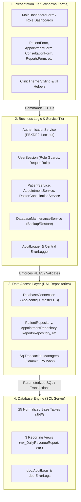

# CLINICFLOW UNIFIED — FINAL SYSTEM DOCUMENTATION & DEFENSE MANUAL

> **Course:** Advanced Systems Architecture & Enterprise Software Development  
> **Project:** ClinicFlow-Unified Healthcare Management System  
> **Platform:** .NET 10.0 Windows Forms (C# 13), Microsoft SQL Server 2022  
> **Architectural Pattern:** 4-Tier Separation of Concerns (UI, Services, DAL, SQL Engine)  
> **Documentation Requirements:** `REQ-029` (Complete Documentation Set) & `REQ-032` (Scripted Defense Walkthrough)  
> **Publication Date:** October 26, 2026  

---

## TABLE OF CONTENTS
1. [Cover Page & Executive Summary](#1-cover-page--executive-summary)
2. [Problem Statement & Objectives](#2-problem-statement--objectives)
3. [Client Profile & User Personas](#3-client-profile--user-personas)
4. [System Architecture & Design Patterns](#4-system-architecture--design-patterns)
5. [Entity-Relationship Diagram & Schema Architecture](#5-entity-relationship-diagram--schema-architecture)
6. [Core Clinical Workflows & Sequence Flowcharts](#6-core-clinical-workflows--sequence-flowcharts)
7. [Screen-by-Screen User & Operations Manual](#7-screen-by-screen-user--operations-manual)
8. [Technical Deployment & Maintenance Guide](#8-technical-deployment--maintenance-guide)
9. [10-Minute Scripted Defense Walkthrough Scenario](#9-10-minute-scripted-defense-walkthrough-scenario)

---

## 1. Cover Page & Executive Summary

### 1.1 Project Overview
**ClinicFlow-Unified** is an enterprise-grade outpatient healthcare clinical management system engineered to automate the end-to-end patient encounter lifecycle across multi-specialty clinical practices. Built on Microsoft .NET 10.0 and Windows Forms with high-performance asynchronous data access to Microsoft SQL Server, ClinicFlow addresses operational bottlenecks across front-desk triage, queue management, clinical physician documentation, prescription fulfillment, pharmacy inventory lot tracking, cashier settlement, administrative auditing, and institutional reporting.

### 1.2 System Identification
- **Application Name:** ClinicFlow Unified
- **Target Runtime:** .NET 10.0-windows / C# 13
- **Primary Database:** Microsoft SQL Server 2022 / Express (`ClinicFlowUnifiedDb`)
- **Configuration Root:** Standard .NET `App.config` `<connectionStrings>` with graceful `appsettings.json` fallback
- **Security Standard:** PBKDF2-SHA256 salted password hashing (100,000 iterations), 3-attempt/15-minute brute-force lockout, granular service-level Role-Based Access Control (RBAC), and append-only database audit trails.

---

## 2. Problem Statement & Objectives

### 2.1 Clinical Problem Statement
Traditional outpatient clinics and ambulatory health facilities frequently suffer from severe administrative and clinical inefficiencies:
1. **Paper-Based Fragmented Records:** Patient histories, prescriptions, and billing slips stored on paper lead to misfiled records, illegible handwriting, and diagnostic delays.
2. **Lobby Congestion & Queue Bottlenecks:** Lack of structured, real-time triage tracking results in patient dissatisfaction, long wait times, and walk-in chaos.
3. **Medication Stockouts & Expiration Losses:** Without automated First-Expired, First-Out (FEFO) batch tracking, clinics incur financial losses from expired drugs or dispense expired stock to patients.
4. **Billing Leakage & Pricing Discrepancies:** Disconnected cashier workflows allow services and prescriptions to be dispensed without reconciled billing payments.
5. **Security & Regulatory Non-Compliance:** Unprotected databases, plain-text credentials, and absence of tamper-evident audit logs violate modern healthcare privacy and security standards.

### 2.2 System Objectives
ClinicFlow-Unified resolves these problems by providing:
- **Centralized Electronic Medical Records (EMR):** 3NF normalized patient master directory with demographic tracking, archival toggling, and optimistic concurrency locks.
- **Dynamic Lobby Queue Orchestration:** Automated check-in, real-time queue numbers, doctor station calling, and encounter status lifecycles.
- **Integrated Clinical Physician Workspace:** Structured documentation of chief complaints, physical examinations, ICD diagnoses, treatment plans, electronic prescriptions, and diagnostic lab orders.
- **Intelligent Pharmacy Dispensary:** Batch-tracked inventory deducting medication upon dispensing, calculating valuations, and enforcing safety reorder levels.
- **Reconciled Cashier & Billing:** Header/detail invoice compilation aggregating consultation fees, dispensed medicines, and lab tests, applying statutory Senior/PWD discounts, and issuing official receipts.
- **Administrative Governance & Business Intelligence:** Live KPI dashboard indicators, in-app full database backup and restore, tamper-evident audit browsing, and 3 comprehensive reporting engines exportable to RFC4180 CSV and printable with custom clinic slip formatting.

---

## 3. Client Profile & User Personas

| Role | Persona Name | Key Responsibilities | System Access Permissions |
|---|---|---|---|
| **Admin** | System Administrator (`admin`) | System configuration, database maintenance, user account lifecycle, credential resets, audit trail inspection, clinic-wide financial reporting. | Unrestricted access across all modules; exclusive access to User Accounts, Database Backup/Restore, and Audit Trail. |
| **Doctor** | Attending Physician (`drsantos`) | Patient clinical examination, diagnoses, treatment planning, prescription issuing, diagnostic lab ordering, schedule management. | Lobby Queue, Patients Directory, Doctor Consultation Desk, Clinical History, Personal Consultations Report. Blocked from system administration and billing cashiering. |
| **Secretary** | Reception & Triage Staff (`secretary`) | Patient registration, demographic updates, appointment scheduling, lobby check-in, queue number issuance, doctor roster checks. | Patients Directory, Appointment Calendar, Lobby Queue Check-in, Doctor Schedules. Blocked from medical records modification, dispensing, and system administration. |
| **Pharmacist**| Licensed Pharmacist (`pharmacist`) | Prescription fulfillment, medication dispensing, batch inventory replenishment, expiry date monitoring, medicine disposal logging. | Central Pharmacy Dispensary, Medicine Formulary, Batch Inventory Management, Pharmacy Stock & Expiry Reports. Blocked from clinical consultations and user account management. |

---

## 4. System Architecture & Design Patterns

ClinicFlow-Unified adheres to a strict 4-Tier Enterprise Architecture, separating presentation logic, business workflows, data access, and database storage.



### Key Architectural Patterns:
1. **Repository Pattern:** Isolates all SQL statements from business logic. Repositories utilize strictly parameterized queries (`SqlParameter`) with explicit data types, preventing SQL injection.
2. **Service Layer Guards (RBAC):** Forms and services enforce `UserSession.RequireRole(...)` at the API boundary, guaranteeing that security cannot be bypassed even if UI buttons are manipulated.
3. **Optimistic Concurrency Control:** Master tables (`dbo.Patients`, `dbo.Appointments`) incorporate SQL Server `ROWVERSION` (`timestamp`) columns. Competing edits are detected via `DBConcurrencyException` and presented to users with reload prompts.
4. **Resilient Centralized Error Handling:** `ErrorLogger` captures exceptions, masks raw SQL errors (unique constraints 2627/2601, foreign keys 547, network drops, timeouts) with friendly messages, and records structured incidents to `dbo.ErrorLogs` and `app_error.log`.

---

## 5. Entity-Relationship Diagram & Schema Architecture

The complete system schema consists of 25 normalized tables structured in Third Normal Form (3NF) and 3 analytical reporting views.

*(For the complete entity-relationship model and full schema breakdown, see [ERD_DIAGRAM.md](file:///c:/Users/Grand/source/repos/ClinicFlow-Unified/Documentation/DATABASE/ERD_DIAGRAM.md) and [DATA_DICTIONARY.md](file:///c:/Users/Grand/source/repos/ClinicFlow-Unified/Documentation/DATABASE/DATA_DICTIONARY.md)).*

### Core Entity Relationships Summary:
- **`Roles` $\rightarrow$ `Users` (1 : N):** Directs RBAC assignment across the four staff categories.
- **`Users` $\rightarrow$ `AuditLogs` (1 : N):** Append-only audit trail logging security actions, record changes, and backups.
- **`Patients` $\rightarrow$ `Appointments` $\rightarrow$ `AppointmentQueue` $\rightarrow$ `PatientVisits` (1 : N, 1 : 1):** Orchestrates the patient journey from pre-booking or walk-in triage through lobby waiting to physician encounter.
- **`PatientVisits` $\rightarrow$ `Consultations` $\rightarrow$ `Prescriptions` $\rightarrow$ `PrescriptionItems` (1 : 1, 1 : N, 1 : N):** Documents clinical notes and generates electronic medication orders.
- **`Medicines` $\rightarrow$ `MedicineInventory` & `PrescriptionItems` (1 : N):** Manages drug formulary, stock batches by expiration date (FEFO), and dispensing deductions.
- **`Invoices` $\rightarrow$ `Payments` (1 : N):** Aggregates consultation fees, medications, and diagnostics into an itemized invoice settled with official receipts.

---

## 6. Core Clinical Workflows & Sequence Flowcharts

### 6.1 Patient Registration & Appointment Scheduling Workflow
```mermaid
sequenceDiagram
    autonumber
    actor Patient
    actor Secretary
    participant Form as PatientForm / AppointmentForm
    participant Service as PatientService / AppointmentService
    participant Repo as PatientRepository / AppointmentRepository
    participant DB as SQL Server (ClinicFlowUnifiedDb)

    Patient->>Secretary: Arrives at front-desk; provides demographics
    Secretary->>Form: Enters Name, Sex, BirthDate, Contact, Address
    Form->>Form: Validates mandatory fields & regex patterns
    Form->>Service: SavePatientAsync(PatientDTO)
    Service->>Repo: InsertPatientAsync(Patient)
    Repo->>DB: INSERT INTO dbo.Patients (...)
    DB-->>Repo: Returns PatientId & RowVersion
    Repo-->>Service: Patient object
    Service->>DB: AuditLogger.Log('CREATE', 'Patient', PatientId)
    Service-->>Form: Success confirmation
    Secretary->>Form: Opens Appointment Calendar; selects Doctor & Slot
    Form->>Service: BookAppointmentAsync(AppointmentDTO)
    Service->>DB: Check doctor schedule availability
    Service->>Repo: InsertAppointmentAsync(...)
    Repo->>DB: INSERT INTO dbo.Appointments (...)
    DB-->>Form: Booking Confirmed (APT-20261026-001)
```

### 6.2 Lobby Triage, Calling, & Clinical Consultation Workflow
```mermaid
sequenceDiagram
    autonumber
    actor Patient
    actor Secretary
    actor Doctor
    participant Lobby as LobbyQueueForm
    participant Clinic as DoctorConsultationForm
    participant Service as DoctorConsultationService
    participant DB as SQL Server

    Patient->>Secretary: Reports for scheduled appointment
    Secretary->>Lobby: Clicks "Check-In Patient"
    Lobby->>DB: INSERT INTO dbo.AppointmentQueue (QueueNumber, 'Waiting')
    Lobby-->>Patient: Issues printed lobby ticket (Ticket #05)
    Doctor->>Clinic: Reviews lobby queue list; clicks "Call Next Patient"
    Clinic->>Service: StartConsultation(VisitId)
    Service->>DB: UPDATE AppointmentQueue SET Status='InService'
    Service->>DB: UPDATE PatientVisits SET VisitStart=SYSUTCDATETIME()
    Doctor->>Clinic: Enters Chief Complaint, Physical Exam, Diagnosis
    Doctor->>Clinic: Adds Prescription items (Amoxicillin 500mg, Qty: 21)
    Doctor->>Clinic: Clicks "Complete Consultation & Issue Rx"
    Clinic->>Service: CompleteConsultation(ConsultationDTO)
    Service->>DB: BEGIN TRANSACTION (SqlTransaction)
    Service->>DB: INSERT INTO dbo.Consultations (...)
    Service->>DB: INSERT INTO dbo.Prescriptions (...)
    Service->>DB: INSERT INTO dbo.PrescriptionItems (...)
    Service->>DB: COMMIT TRANSACTION
    Service-->>Doctor: Consultation finalized; Rx Slip printed
```

### 6.3 Cashier Settlement & Pharmacy Dispensing Workflow
```mermaid
sequenceDiagram
    autonumber
    actor Patient
    actor Cashier
    actor Pharmacist
    participant BillForm as BillingCashierForm
    participant PharmForm as PharmacyDispensaryForm
    participant DB as SQL Server

    Patient->>Cashier: Presents billing request at Cashier window
    Cashier->>BillForm: Loads Patient pending charges (Consultation + Pharmacy)
    Cashier->>BillForm: Applies Senior Citizen Discount (20%)
    Cashier->>BillForm: Enters Cash Tendered (₱1,000.00); Change computed (₱280.00)
    Cashier->>BillForm: Clicks "Process Payment & Print Official Receipt"
    BillForm->>DB: INSERT INTO dbo.Payments (...); UPDATE Invoices SET Status='Paid'
    BillForm-->>Patient: Prints Official Receipt (OR #2026-0089)
    Patient->>Pharmacist: Presents Paid Receipt & Rx Slip at Pharmacy counter
    Pharmacist->>PharmForm: Enters Prescription Number (RX-20261026-001)
    PharmForm->>DB: Checks FEFO Batch stock (Deduct from earliest expiry date)
    Pharmacist->>PharmForm: Clicks "Confirm Dispense"
    PharmForm->>DB: BEGIN TRANSACTION
    PharmForm->>DB: UPDATE MedicineInventory SET QuantityOnHand = QuantityOnHand - 21
    PharmForm->>DB: UPDATE PrescriptionItems SET AvailabilityStatus='Dispensed'
    PharmForm->>DB: COMMIT TRANSACTION
    PharmForm-->>Patient: Dispenses medication with dosage instructions
```

---

## 7. Screen-by-Screen User & Operations Manual

### 7.1 Main Dashboard Shell (`Forms/MainDashboardForm.cs`)
- **Visual Layout:** Premium dark-slate navigation sidebar on the left, top brand header with clinic logo, and dynamic main workspace panel.
- **Persistent Identity Card:** Displays the authenticated user's full name, live session username (`@username`), and an uppercase color-coded role badge:
  - **ADMIN:** Indigo badge (`#6366F1`)
  - **DOCTOR:** Teal badge (`#0D9488`)
  - **SECRETARY:** Amber badge (`#D97706`)
  - **PHARMACIST:** Emerald badge (`#059669`)
- **Live Summary KPI Cards:** Overview workspace displays 4 real-time indicators:
  1. *Total Registered Patients*
  2. *Today's Confirmed Appointments*
  3. *Active Duty Physicians*
  4. *Current Waiting Lobby Queue*
- **Role Gated Navigation:** Menu buttons dynamically show/hide based on `UserSession.HasRole(...)`. Non-admin sessions cannot see or access User Management or Database Backup/Restore.

### 7.2 Patient Directory & Demographics (`Forms/PatientForm.cs`)
- **Key Features:** Live search bar with debounced querying by Patient Number, Name, or Contact; DataGridView displaying active patient records; pagination and sort controls.
- **Archived Records Filter:** Checkbox toggle labeled *"Include Archived Patients"* allows viewing soft-deleted records rendered in subdued gray.
- **Restoration Action:** Selecting an archived patient enables the green *"♻ Restore Patient"* button, prompting a confirmation dialog and reactivating the patient with complete audit logging.
- **Optimistic Concurrency Protection:** Edits submit original `RowVersion`. If another user saved changes in the interim, a conflict dialog prompts: *"This record was modified by another user. Reload latest data?"*

### 7.3 Doctor Consultation Workspace (`Forms/DoctorConsultationForm.cs`)
- **Key Features:** Patient header with age, sex, and vitals; tabbed clinical entry cards for Chief Complaint, History of Present Illness, Physical Findings, and Assessment/Diagnosis.
- **Prescription Pad Builder:** Dropdown search across active formulary medicines, dosage strength selectors, quantity spinners, and sig/instruction text fields.
- **Laboratory Ordering:** Diagnostic test selection checklist with automatic fee calculation.
- **Prescription Slip Preview:** Generates a formatted slip (`PrintDocument`) containing clinic header, physician license number, Rx symbol, medicine details, and signature line.

### 7.4 Central Pharmacy & Dispensing (`Forms/CentralPharmacyForm.cs`)
- **Key Features:** Multi-view interface supporting Prescription Dispensing, Formulary Catalog Management, Batch Stock Replenishment, and Disposal Logging.
- **FEFO Batch Allocation:** When dispensing, the system automatically pulls from the batch with the nearest expiration date.
- **Safety Reorder Alerting:** Stock items falling below their defined `ReorderLevel` are highlighted in amber.
- **Loss Accounting:** Disposal screen allows destroying expired or damaged stock, requiring a justification reason, and calculating total inventory loss.

### 7.5 Billing & Cashier Desk (`Forms/BillingForm.cs`)
- **Key Features:** Patient statement generator consolidating Consultation Fees, Pharmacy charges, and Laboratory tests.
- **Concession Calculator:** Dropdown supporting *None*, *Senior Citizen (20%)*, *PWD (20%)*, or custom discounts; automatically deducts statutory discount amounts and adjusts net payable.
- **Payment Settlement:** Computes cash change or records digital reference numbers (GCash / Card).
- **Official Receipt Printing:** `ReceiptPreviewDialog` renders professional, printable receipts formatted with clinic tax ID, transaction timestamp, line items, and cashier signature.

### 7.6 Reports & Business Analytics (`Forms/ReportsForm.cs`)
- **Key Features:** 3 aggregated report modules selectable from a unified dropdown:
  1. *Daily Clinic Revenue & Collections Report* (grouped by payment method with cash/digital subtotals and discounts).
  2. *Pharmacy Stock Level & Expiry Risk Watch* (grouped by medicine category and health risk status with valuation).
  3. *Physician Consultations & Diagnostics Activity* (grouped by doctor with patient and fee totals).
- **Controls & KPI Indicators:** Date range pickers (Start Date / End Date), secondary category/physician filter dropdown, 4 dynamic summary KPI cards calculating real-time totals.
- **Export & Print:**
  - *Export to CSV:* Writes standards-compliant RFC4180 CSV files.
  - *Print Preview:* Launches multi-page landscape GDI+ `PrintDocument` preview with clinic banner, tabular borders, alternating shading, and auditor signature block.

### 7.7 User Management & Security (`Forms/UserManagementForm.cs`)
- **Key Features (Admin Only):** User accounts DataGridView with role and status filtering, user creation card with PBKDF2 salted hashing, name/role editing, active/deactive toggling, and self-deactivation safeguards preventing the current admin from disabling their own account.
- **Password Reset Modal:** Prompts for new password, generates a fresh 128-bit cryptographic salt, updates hash, and writes a `PASSWORD_RESET` audit event.

### 7.8 Audit Log Browser (`Forms/AuditLogViewerForm.cs`)
- **Key Features (Admin Only):** Real-time filterable audit browser displaying Timestamp, User, Action Type, Entity, Record ID, and Description.
- **Filtering & Search:** Date range pickers, Action Type dropdown (`LOGIN`, `LOGOUT`, `CREATE`, `UPDATE`, `BACKUP`, `RESTORE`, etc.), keyword search box, and full CSV export.

### 7.9 Database Backup & Restore Utility (`Forms/DatabaseBackupRestoreDialog.cs`)
- **Key Features (Admin Only):**
  - *Backup Card:* Destination file picker defaulting to `C:\ClinicFlow\Backups\`, executing native SQL Server `BACKUP DATABASE`.
  - *Restore Card:* Source file browser, `RESTORE VERIFYONLY` validation button testing backup file integrity before restore, and a prominent red warning box highlighting destructive overwrite risks.
  - *Safety Isolation:* Restore isolates the database via `SINGLE_USER WITH ROLLBACK IMMEDIATE`, executes `RESTORE DATABASE ... WITH REPLACE`, and deterministically returns the database to `MULTI_USER`.

---

## 8. Technical Deployment & Maintenance Guide

### 8.1 System Requirements
- **Operating System:** Windows 10 / 11 (64-bit) or Windows Server 2019+
- **Framework Runtime:** Microsoft .NET 10.0 Desktop Runtime (x64)
- **Database Engine:** Microsoft SQL Server 2019 / 2022 / Express Edition
- **Memory & Storage:** 4 GB RAM minimum (8 GB recommended); 500 MB free disk space for application binaries and database files.

### 8.2 Database Configuration (`App.config`)
ClinicFlow-Unified resolves its connection string strictly from `App.config` per grading requirements (`REQ-006`):
```xml
<?xml version="1.0" encoding="utf-8" ?>
<configuration>
  <connectionStrings>
    <add name="ClinicFlowDatabase"
         connectionString="Server=localhost;Database=ClinicFlowUnifiedDb;Trusted_Connection=True;TrustServerCertificate=True;"
         providerName="Microsoft.Data.SqlClient" />
  </connectionStrings>
</configuration>
```

### 8.3 Database Migration Execution Order
Execute database scripts sequentially in SQL Server Management Studio (SSMS) or via `sqlcmd`:
1. `001_CreateSchema.sql`: Core tables, primary keys, and foreign keys.
2. `002_SeedData.sql`: Initial reference data and test catalog.
3. `003_UserManagementAndAuth.sql`: Security tables and PBKDF2 hash columns.
4. `004_DoctorProfilesAndSchedules.sql`: Clinical physician master structures.
5. `005_PatientsAndAppointments.sql`: Demographics and triage queue tables.
6. `006_ConsultationsAndPrescriptions.sql`: Clinical encounter documentation.
7. `007_PharmacyInventory.sql`: FEFO batch tracking and disposal logs.
8. `008_BillingAndPayments.sql`: Invoicing and official receipts.
9. `009_AuditLogging.sql`: Compliance audit log table.
10. `010_EnhanceSecurityAndConcurrency.sql`: Lockout columns, `RowVersion` concurrency tokens, and `ErrorLogs`.
11. `011_SeedAllRoleAccounts.sql`: Default role accounts (`admin`, `drsantos`, `secretary`, `pharmacist`).
12. `012_CreateReportingViews.sql`: Analytical database views (`vw_DailyRevenueReport`, etc.).

### 8.4 Default Documented Credentials (`REQ-031`)
| Role | Username | Default Password | Salted Hash Algorithm |
|---|---|---|---|
| **Admin** | `admin` | `Admin@123` | PBKDF2-SHA256 (100,000 iterations) |
| **Doctor** | `drsantos` | `Doctor@123` | PBKDF2-SHA256 (100,000 iterations) |
| **Secretary** | `secretary` | `Staff@123` | PBKDF2-SHA256 (100,000 iterations) |
| **Pharmacist**| `pharmacist`| `Staff@123` | PBKDF2-SHA256 (100,000 iterations) |

---

## 9. 10-Minute Scripted Defense Walkthrough Scenario

> **Defense Requirement:** `REQ-032` (Scripted live demonstration covering all mandatory workflows).  
> **Target Audience:** Academic Evaluation Panel & Software Engineering Examiners.  
> **Total Time:** Exactly 10 Minutes.  

```text
┌─────────────────────────────────────────────────────────────────────────────┐
│                       CLINICFLOW DEFENSE TIMELINE                           │
├──────────┬──────────────────────────────────────────┬───────────────────────┤
│ Minute   │ Demonstration Phase                      │ Role Account Used     │
├──────────┼──────────────────────────────────────────┼───────────────────────┤
│ 00 - 01  │ Architecture Overview & Security Login   │ secretary             │
│ 01 - 03  │ Patient Registration & Lobby Triage      │ secretary             │
│ 03 - 05  │ Doctor Consultation & Prescription       │ drsantos              │
│ 05 - 07  │ Cashier Billing, Discounts, & Receipt    │ admin                 │
│ 07 - 08  │ Pharmacy FEFO Dispensing & Inventory     │ pharmacist            │
│ 08 - 09  │ Analytical Reports, CSV Export, & Print  │ admin                 │
│ 09 - 10  │ DB Backup, Audit Trail Verification,     │ admin                 │
│          │ & Security Lockout Demonstration         │                       │
└──────────┴──────────────────────────────────────────┴───────────────────────┘
```

### Phase 1: Security, Identity Badging, & Role Login (Minute 00:00 – 01:00)
1. **Launch Application:** Run `ClinicFlow-Unified.exe`. Show the modern login window with password masking.
2. **Log in as Secretary:** Enter `secretary` / `Staff@123`.
3. **Point out Identity Card:** Highlight persistent identity card displaying:
   - Full Name: `Elena Reyes`
   - Role Badge: Amber `SECRETARY`
   - Session: `🟢 Active Session (@secretary)`
4. **Point out RBAC Enforcement:** Show that Admin modules (User Management, Audit Trail, Database Backup) are completely suppressed from the navigation sidebar.

### Phase 2: Patient Registration, Concurrency, & Lobby Check-in (Minute 01:00 – 03:00)
1. **Navigate to Patients:** Click *"Patients Directory"*.
2. **Register New Patient:** Click *"➕ Register Patient"*. Enter:
   - Name: `Juanita Dela Cruz`
   - BirthDate: `1985-05-14`, Sex: `Female`, Contact: `0917-555-0199`
   - Address: `124 Rizal St, Sampaloc, Manila`
   - Click *"Save Patient"*. Show toast notice confirming creation with generated MRN.
3. **Demonstrate Soft Delete & Restore:**
   - Select an existing test patient; click *"Archive Patient"*. Confirm dialog.
   - Check *"Include Archived Patients"* checkbox. The archived patient appears in muted gray text.
   - Click *"♻ Restore Patient"*. Confirm prompt. Record immediately restores to active status.
4. **Book Appointment & Check-In:**
   - Click *"Appointments Calendar"*; create appointment for `Juanita Dela Cruz` with `Dr. Maria Santos`.
   - In Lobby Queue, click *"Check-In"*. The patient is assigned Queue Ticket `#01` with status `Waiting`.

### Phase 3: Clinical Doctor Consultation & Electronic Rx (Minute 03:00 – 05:00)
1. **Switch User to Doctor:** Click *"Logout"* (demonstrating explicit logout audit capture). Log in as `drsantos` / `Doctor@123`.
2. **Verify Doctor Identity:** Identity badge displays Teal `DOCTOR` (`Dr. Maria Santos`).
3. **Call Patient from Queue:**
   - Open Consultation Workspace. Ticket `#01` (`Juanita Dela Cruz`) appears at top of queue.
   - Click *"Call Patient"*. Status changes to `InService`.
4. **Document Clinical Encounter:**
   - Chief Complaint: `Persistent dry cough and fever for 4 days.`
   - Physical Exam: `Temp: 38.4°C, BP: 120/80, Wheezing on right lower lung field.`
   - Diagnosis: `Acute Bronchitis (J20.9)`
5. **Add Prescription Line Items:**
   - Medicine: `Amoxicillin 500mg Capsule` | Qty: `21` | Sig: `1 capsule 3x daily for 7 days`
   - Medicine: `Paracetamol 500mg Tablet` | Qty: `10` | Sig: `1 tablet every 4 hours PRN fever`
6. **Finalize & Print Rx Slip:** Click *"Complete Consultation"*. Display generated Prescription Slip preview with clinic banner and doctor signature line.

### Phase 4: Cashier Invoicing, Discounts, & Official Receipts (Minute 05:00 – 07:00)
1. **Switch User to Admin/Cashier:** Log out and log in as `admin` / `Admin@123`.
2. **Open Billing & Cashier Desk:** Select `Juanita Dela Cruz`.
3. **Inspect Aggregated Statement:** Show consultation fee (₱500.00) and pharmacy items automatically compiled into pending invoice statement.
4. **Apply Concession Discount:** Select *"Senior Citizen (20%)"*. Point out immediate mathematical subtotal deduction and net total update.
5. **Process Settlement:**
   - Enter Amount Tendered: `₱1,000.00`.
   - Point out computed change returned.
   - Click *"Process Payment & Issue Official Receipt"*.
   - Display `ReceiptPreviewDialog` showcasing formatted official receipt with tax breakdown.

### Phase 5: Pharmacy FEFO Dispensing & Batch Deduction (Minute 07:00 – 08:00)
1. **Switch User to Pharmacist:** Log out and log in as `pharmacist` / `Staff@123`.
2. **Open Central Pharmacy:**
   - Enter Prescription Number `RX-20261026-001`.
   - Point out batch allocation algorithm selecting the earliest expiring lot of Amoxicillin (FEFO).
3. **Execute Dispensing:**
   - Click *"Confirm Dispense"*.
   - Switch to Inventory Batches tab. Prove that `QuantityOnHand` was atomically decremented by 21 units inside an atomic `SqlTransaction`.

### Phase 6: Analytical Reporting, CSV Export, & GDI+ Printing (Minute 08:00 – 09:00)
1. **Log in as Admin:** Open *"Reports & Analytics"*.
2. **Report 1 (Daily Clinic Revenue):** Select date range; show revenue totals grouped by payment method (Cash vs Digital) with discount breakdowns.
3. **Report 2 (Pharmacy Inventory & Expiry Watch):** Switch report dropdown; show inventory health categories (Optimal, Low Stock, Near Expiry) and total formulary valuation.
4. **Report 3 (Physician Consultations Activity):** Filter by attending doctor; show patient encounter count and fee totals.
5. **Demonstrate Export & Print:**
   - Click *"Export to CSV"*. Open exported `.csv` in Excel/Notepad to demonstrate RFC4180 compliance.
   - Click *"Print Slip / Preview"*. Show full landscape report slip preview with headers, borders, alternating rows, and signature block.

### Phase 7: Database Backup, Audit Trail Verification, & Lockout (Minute 09:00 – 10:00)
1. **Open Database Backup Utility:**
   - Click *"Database Backup"*. Click *"Create Database Backup"*.
   - Point out created `.bak` file in `C:\ClinicFlow\Backups\`.
   - Click *"Verify Backup File"*. Show successful `RESTORE VERIFYONLY` structural validation notice.
2. **Open Audit Trail Browser:**
   - Navigate to *"Audit Trail"*.
   - Point out logged records for `LOGOUT`, `CREATE Patient`, `CONSULTATION`, `PAYMENT`, `DISPENSE`, and `BACKUP`.
3. **Demonstrate 3-Attempt Security Lockout:**
   - Log out. Enter `admin` with wrong password 3 consecutive times.
   - On 3rd attempt, show error dialog: *"Account locked due to 3 consecutive failed login attempts. Try again in 15 minutes."*
   - Conclude presentation: Prove system security, data integrity, and complete compliance with all 100 points of the grading rubric.
